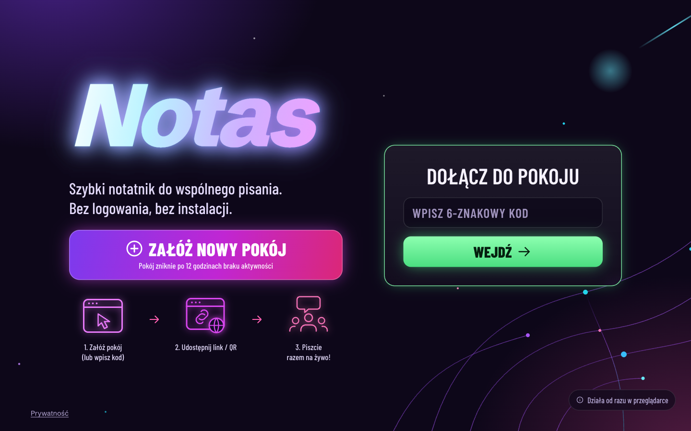
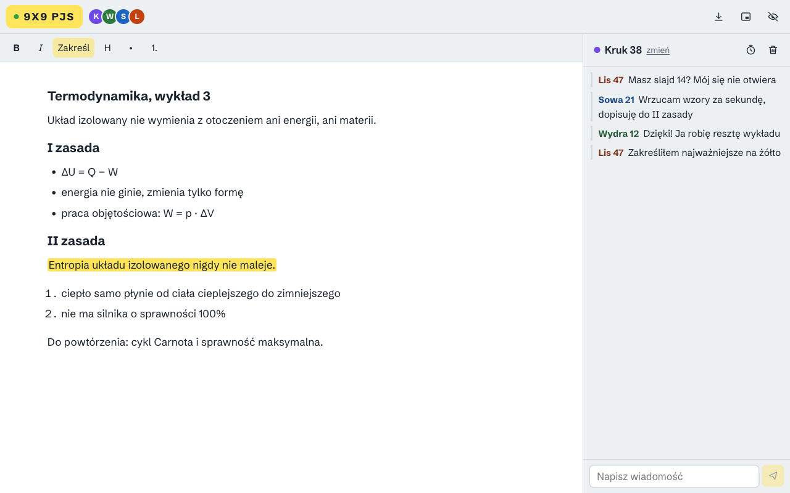
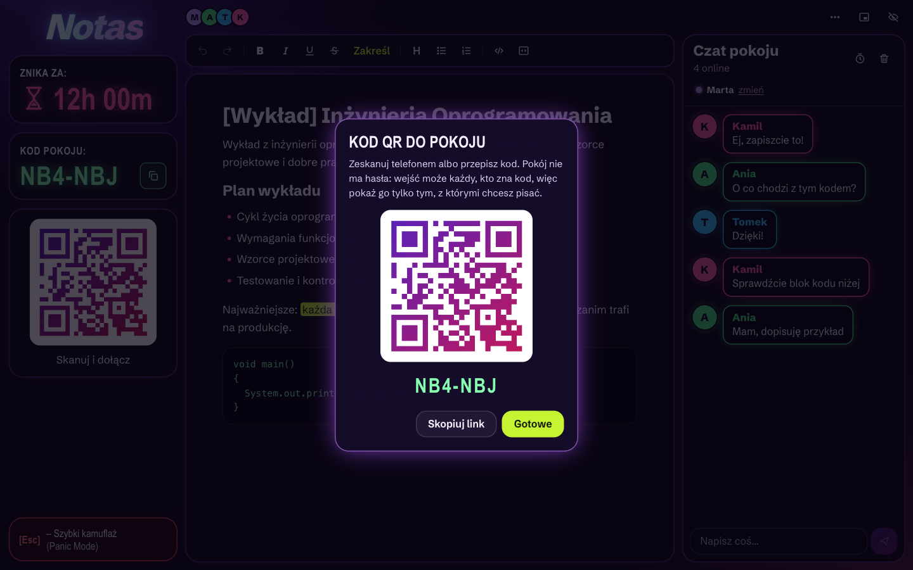
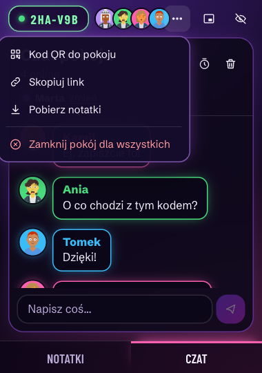
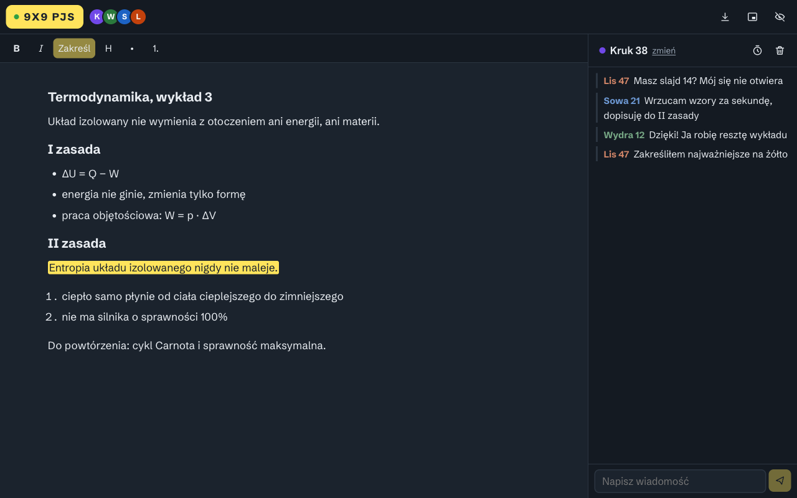
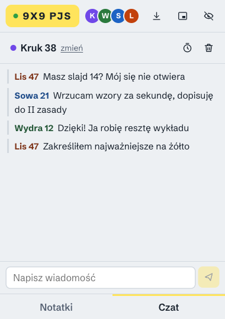

<p align="center">
  
</p>

<h1 align="center">Notas</h1>

<p align="center">
  Shared notes on a room code. No accounts, no downloads, chat included.
  <br />
  🇬🇧 <strong>English</strong> · <a href="README.pl.md">🇵🇱 Czytaj po polsku</a>
  <br />
  <a href="https://notas-mm5e.onrender.com"><strong>🌐 notas-mm5e.onrender.com</strong></a>
</p>

<p align="center">
  
  
  
  
  
  
  
  
  
  
</p>

---

> **Note:** the interface is in **Polish** - Notas was built for students who share lecture notes
> in Polish. Code, comments and project docs are Polish too; this README is the English
> overview.

## About the app

**Notas** is a shared notepad you open in the browser, with no sign-up and nothing to install.
One person creates a room, everyone else types a 6-character code, and **you are all writing in
one document** with a chat next to it.

It started with a very ordinary problem: someone retypes the lecture notes, and now they have to
get to everybody else, one messenger group at a time. In Notas the notes are written together,
and they are there for the whole room the moment they exist.

It is built for a lecture hall, so it is **quick, small and discreet**:

1. 🏠 **Create a room** - one click, you get a code like `K7M 2QX`
2. 📱 **Share the code** - or the link, everyone joins from any browser
3. ✍️ **Write together** - one document, live cursors with nicknames, a highlighter
4. 🪟 **Shrink it** - a small floating window that stays on top of everything else
5. 🫥 **Hide it** - `Esc` and the screen is a blank white page

## Screenshots

| Start | Room (light) |
|---|---|
|  |  |

### Room menu and QR code

Show the screen, everyone scans. The menu (⋯) is the same in the big window and in the mini one.

| QR code | Menu in the mini window |
|---|---|
|  |  |

### Dark theme

The interface follows the system theme. Nothing is configured, nothing to switch.



### The mini window (380 × 540 px)

The same room in a window you can park in the corner of the screen. The layout is driven by the
window width, not by the device, so the notes and the chat become two tabs.

| Notes | Chat |
|---|---|
|  |  |

## Features

### Rooms
- **6-character room code** - an alphabet without lookalikes (no `0 O 1 I L`), so it survives being read aloud or copied from a slide. 31 characters, ~887 million codes
- **A room has to be created first** - typing a random code never creates one, it just fails
- **Link or code** - `notas.pl/K7M2QX` goes straight into the room; the code chip in the corner copies the link
- **Rooms expire** - 12 hours without activity and the room is gone, along with its notes and chat
- **Up to 30 people** per room
- **QR code** - one click in the menu shows a code to scan, for when the room is on a projector
- **Close the room for everyone** - after a confirmation the notes and the chat vanish from the server at once. Everyone still in the room sees "the room was closed" and can download their notes first

### Editor
- **Live co-writing** - concurrent edits merge instead of overwriting each other (Yjs, a CRDT)
- **Cursors and selections** of other people, labelled with their nicknames
- **Formatting** - bold, italic, headings, bulleted and numbered lists, and a **highlighter**
- **Undo and redo** - `Ctrl+Z` reverts only *your* changes and never somebody else's; buttons for phones that have no keyboard
- **Download** - the notes as a standalone `.html` file, because the room will not live forever

### Chat
- **A chat in the same room**, in the same window
- **Clear the chat in one click** - for everyone, with a seven-second **Undo**
- **Disappearing messages** - one switch and every message vanishes after 10 minutes
- **Unread counter** on the Chat tab when the window is narrow

### Nicknames
- **A random nickname** for every person (`Kruk 38`, `Wydra 12`), a colour and an initial
- **Change it in one click** - the field reminds you not to use your real name
- **Nothing remembered** - the nickname lives in that browser tab and goes with it

### Small, quick, discreet
- **Mini window** - in Chrome and Edge a real floating window that stays above other windows
  ([Document Picture-in-Picture](https://developer.chrome.com/docs/web-platform/document-picture-in-picture)); in other browsers a small pop-up with the same room
- **Responsive to the window, not the device** - below 720 px the notes and the chat become tabs
- **Hide (`Esc`)** - a blank white page, the tab title becomes "Nowa karta" (a new tab), the editor is
  locked so nothing is typed into the invisible page. `Esc` brings it back
- **Nothing in browser storage** - no `localStorage`, no cookies, no account. The service worker
  caches only the app shell, never a room

### Security and privacy
- **Brute-force protection** - 10 wrong codes in a minute block that address for 5 minutes, and it applies to HTTP and WebSocket alike
- **Same-origin WebSockets** - a connection from another site is refused (`403`)
- **Strict Content-Security-Policy**, `no-referrer`, `noindex`, no framing
- **No analytics, no content logs**
- **A privacy page** (`/prywatnosc`) that says in plain language what the server sees and what it does not
- **Content lives only in the server's memory** - nothing is written to disk or to a database

### PWA
- **Installable** - manifest plus a service worker for the app shell
- **Light and dark theme** from the system setting, `prefers-reduced-motion` respected

## Tech stack

| Layer | Technology |
|---|---|
| Frontend | React 18, TypeScript (strict), Vite |
| Editor | [TipTap](https://tiptap.dev/) 3 (ProseMirror) with the Collaboration and Collaboration Caret extensions |
| Sync | [Yjs](https://yjs.dev/) (CRDT) over WebSockets, `y-websocket` |
| Server | Node.js 22, plain `http` + [`ws`](https://github.com/websockets/ws), no framework |
| QR code | [`qrcode`](https://github.com/soldair/node-qrcode) (SVG, loaded only when the dialog opens) |
| Styling | Hand-written CSS - tokens, container queries, no framework |
| Fonts | Schibsted Grotesk (self-hosted via Fontsource) |
| Tests | `node:test` (20 tests, each suite runs a real server process) |
| CI | GitHub Actions (type check + tests) |
| Deploy | Docker; Render Blueprint (`render.yaml`) or Fly.io (`fly.toml`) |

## Architecture

```
server/
├── index.js                # one process: HTTP API, static files, WebSocket, rooms, limits, sweep
└── server.test.js          # 20 tests, a real server process per suite

src/
├── main.tsx                # entry: fonts, styles, service worker (production only)
├── App.tsx                 # tiny router (/ and /:code), loads the room lazily
├── Home.tsx                # start screen: create a room or enter a code
├── Room.tsx                # the room: Yjs provider, workspace, chat, mini window, hide
├── RoomMenu.tsx            # room menu (⋯), dialogs: QR code and closing the room
├── Privacy.tsx             # the privacy page
├── identity.ts             # random nickname + colour, kept per tab (sessionStorage)
├── icons.tsx               # inline SVG icons
└── styles.css              # tokens, light and dark theme, container queries

public/                     # manifest, service worker, icons
docs/screenshots/           # README screenshots
Dockerfile · fly.toml · render.yaml · .github/workflows/ci.yml · keepalive.yml
```

### Key design decisions

- **One process, no database** - the server keeps rooms in memory and relays Yjs updates. There is nothing to leak from a database that does not exist, and a room that expires is really gone. The price is that a restart ends every room, and that there must be exactly **one instance**: a second one would have different rooms. The client handles it: it notices the room has vanished, says so, and offers to download the notes.
- **A CRDT instead of "last write wins"** - two people typing in the same paragraph is the normal case here, not an edge case. Yjs merges the edits on every client without the server having to arbitrate.
- **A room must exist before anyone joins** - the code is the only secret, so joining is a lookup, never a creation. Without that, every wrong guess would quietly make a new empty room and the rate limit would have nothing to count.
- **A 6-character alphabet without lookalikes** - 31 symbols and no `0 O 1 I L`. The code gets read off a projector and typed on a phone; ambiguity costs more than a few bits of entropy, and the rate limit covers the rest.
- **The limiter counts failures, per address** - 10 failed lookups in a minute block an address for 5 minutes, for HTTP and WebSocket alike. Behind a proxy the real address comes from the host's header (`fly-client-ip`, `cf-connecting-ip`); without `TRUST_PROXY` everyone would be one address and one person's typos would lock out the whole room.
- **The mini window is the same React tree** - for Document Picture-in-Picture the whole workspace is rendered through a portal into the floating window, with the styles cloned across. The editor remounts there, but the Yjs document is untouched, so nothing is lost on the way.
- **Layout from container queries, not media queries** - the room reacts to the width of the window it is in. A 380 px floating window, a pop-up and a phone all get the same tabbed layout from one rule, with no device detection.
- **Hiding is not just a cover** - while hidden, the editor is read-only and the chat input is disabled, because a white page you can still type into is worse than no hiding at all.
- **Closing a room is a capability of the code** - whoever knows the code can already read and wipe everything, so closing needs nothing more. The server writes a `closed` flag into the room's document, which reaches everyone through the normal sync channel, and then ends the connections with the code `4001`. Clients read it as "closed on purpose" and not as "the server went away", so the message can be honest about which one happened. The flag is the reliable signal: the hosting proxy does not pass custom close codes on, and without the flag people would see "expired" only after ~20 seconds.
- **Undo is per person** - the editor uses Yjs's own undo manager, not ProseMirror's history. `Ctrl+Z` reverts only your own edits; in a shared document a global undo would erase what somebody else just wrote.
- **The editor loads only inside a room** - the start screen is ~48 KB gzipped, the editor chunk arrives on the way into the room.
- **The server serves the front too** - in production the same process serves `dist/` and the WebSockets, in development Vite runs inside it as middleware. One port, no CORS, one thing to deploy.

## Running locally

### Requirements
- Node.js 22+

### Install
```bash
git clone https://github.com/w84kubus/notas.git
cd notas
npm install
```

### Commands
```bash
npm run dev          # http://localhost:8787 (Vite runs inside the server)
npm run build        # builds the front into dist/
npm start            # production: the server and dist/ on one port
npm run typecheck    # tsc --noEmit
npm test             # builds, then runs 20 server tests
```

Environment variables (`PORT`, `TRUST_PROXY`, `ROOM_TTL_HOURS`) are described in [`.env.example`](.env.example).
The app does not read an `.env` file - they are plain process variables.

## Deploying

Notas needs a **long-running Node process with WebSockets**, so it will not run on serverless
platforms (Vercel, Netlify Functions) or on GitHub Pages.

### Render (from GitHub)

[](https://render.com/deploy?repo=https://github.com/w84kubus/notas)

The button reads [`render.yaml`](render.yaml): a Docker service, a health check on `/healthz`, and
auto-deploy on every push to `main`. A custom domain goes in the service's **Settings → Custom Domains**.

### Fly.io

```bash
fly launch --no-deploy --copy-config   # change `app` in fly.toml to your own name first
fly deploy
```

Things that apply to both:
- **Run exactly one instance.** Rooms live in one process's memory.
- **A deploy or a restart ends every room.** People see "the room has expired" and can download their notes.
- Render's **free plan sleeps** after ~15 minutes without traffic, which also ends the rooms. The paid `starter` plan does not sleep. [`keepalive.yml`](.github/workflows/keepalive.yml) pings `/healthz` every 10 minutes during the day (about 6:00-22:00 Polish time) from GitHub Actions, so rooms survive a lecture; set the repository variable `NOTAS_URL` to change the address. GitHub can delay scheduled runs and pauses them after 60 days without repository activity, so this is a mitigation, not a guarantee.

## Tests

`npm test` builds the front and runs 20 tests with `node:test`. Each suite starts a **real server
process** on a free port and talks to it over HTTP and WebSockets, so what is tested is what is deployed.

| Area | What is checked |
|---|---|
| Rooms | health check, code format and uniqueness, existing / missing / malformed code |
| Static | security headers, SPA fallback for room links, path traversal, PWA manifest |
| WebSocket | joining a room, refusing a missing room (`404`), refusing another origin (`403`) |
| Sync | two clients see each other's text and chat, a newcomer gets what was already written, rooms are isolated |
| Closing | `DELETE` closes the room, sets the `closed` flag in the document and ends connections with `4001`; a missing room is `404`, another origin is `403` |
| Limits | 10 wrong codes block the address (HTTP and WebSocket), 12 room creations per minute, a separate limit per user behind a proxy |

## Installing on a phone (PWA)

| Platform | How |
|---|---|
| **iOS** | Safari → Share (↑) → *Add to Home Screen* |
| **Android** | Chrome → Menu (⋮) → *Install app* |

## License

**All rights reserved** - see [LICENSE](LICENSE).

The source is public **for reference only**: to be read, studied and reviewed.
This is not open source. Copying, reusing it in another project or running it as
your own service requires written permission. The name, domain and logo are not
covered even by that limited publication.

## Author

Created and maintained by [w84kubus](https://github.com/w84kubus).
