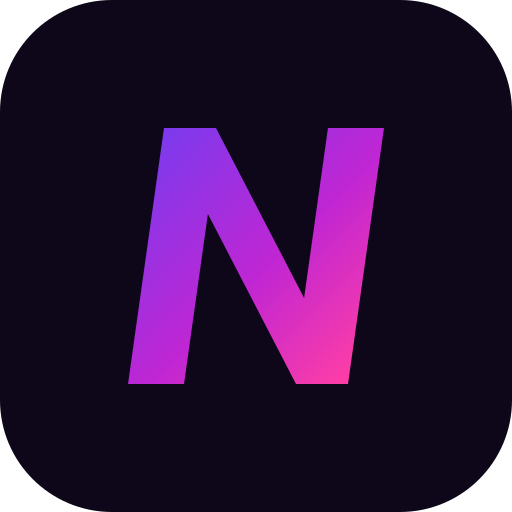
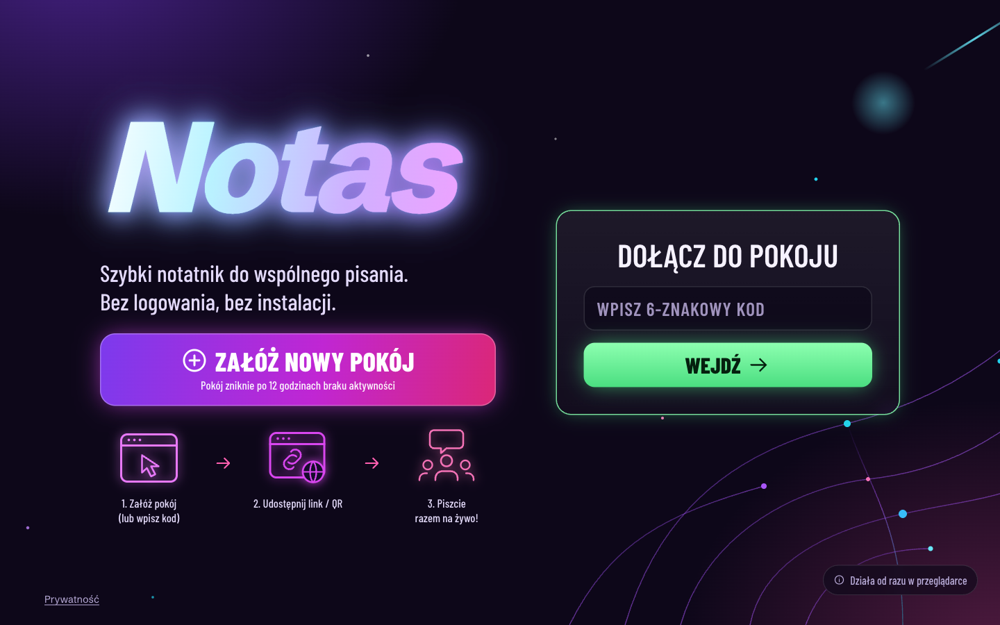
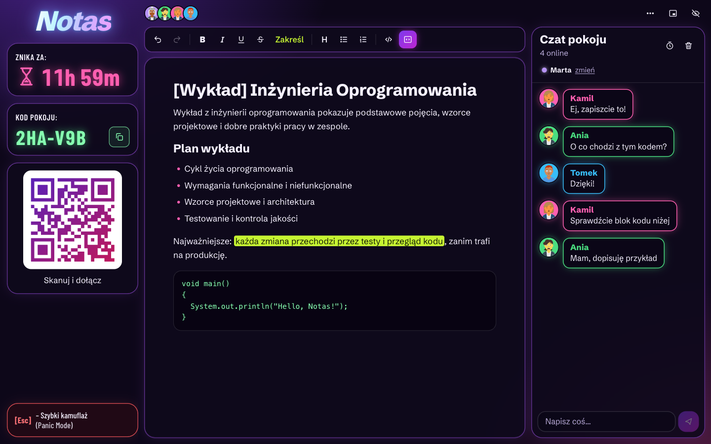
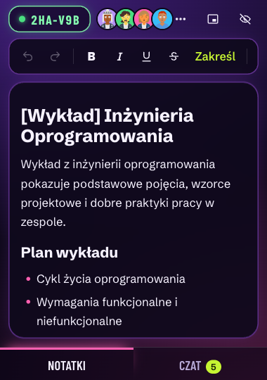
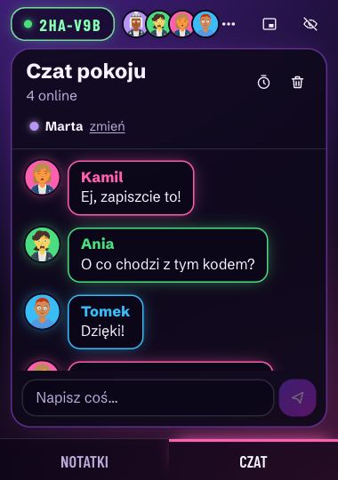
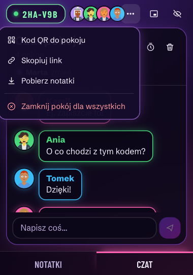
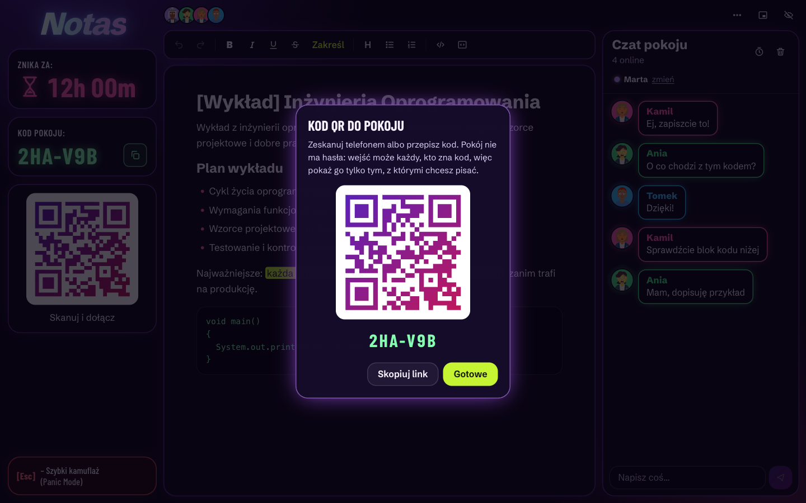

<p align="center">
  
</p>

<h1 align="center">Notas</h1>

<p align="center">
  Wspólne notatki na kod pokoju. Bez kont, bez pobierania, z czatem.
  <br />
  🇵🇱 <strong>Polski</strong> · <a href="README.md">🇬🇧 Read in English</a>
  <br />
  <a href="https://notas-mm5e.onrender.com"><strong>🌐 notas-mm5e.onrender.com</strong></a>
</p>

<p align="center">
  
  
  
  
  
  
  
  
  
  
</p>

---

## O aplikacji

**Notas** to wspólny notatnik, który otwierasz w przeglądarce - bez rejestracji i bez instalowania
czegokolwiek. Jedna osoba zakłada pokój, reszta wpisuje 6-znakowy kod i **wszyscy piszecie w jednym
dokumencie**, a obok jest czat.

Pomysł wziął się ze zwykłego problemu: ktoś przepisuje notatki z wykładu, a potem trzeba je jakoś
dostarczyć reszcie roku, grupa po grupie. W Notas notatki powstają wspólnie i są u wszystkich od
pierwszej linijki.

Aplikacja jest robiona pod salę wykładową, więc ma być **szybka, mała i dyskretna**:

1. 🏠 **Zakładasz pokój** - jedno kliknięcie, dostajesz kod w stylu `K7M 2QX`
2. 📱 **Podajesz kod** - albo link, każdy wchodzi z dowolnej przeglądarki
3. ✍️ **Piszecie razem** - jeden dokument, żywe kursory z pseudonimami, zakreślacz, bloki kodu
4. 🪟 **Zmniejszasz** - małe, pływające okno, które zostaje nad innymi
5. 🫥 **Ukrywasz** - `Esc` i na ekranie jest pusta, biała strona

## Zrzuty ekranu

Wygląd to ciemny motyw „neon”: głęboka fioletowa noc, szklane panele ze świecącymi krawędziami i jedno gradientowe logo.

| Start | Pokój |
|---|---|
|  |  |

Na szerokim ekranie pokój ma trzy kolumny: pasek boczny (ile pokój jeszcze pożyje, kod, kod QR i przycisk **Panic Mode**), notatki i czat.

### Okno mini (380 × 540 px)

Ten sam pokój w oknie, które zaparkujesz w rogu ekranu. Układ zależy od szerokości okna, a nie od
urządzenia, więc notatki i czat zamieniają się w dwie zakładki.

| Notatki | Czat | Menu |
|---|---|---|
|  |  |  |

### Kod QR

Pokazujesz ekran, wszyscy skanują. Kod jest fioletowo-różowy na białej karcie, więc telefony czytają go pewnie.



## Funkcje

### Pokoje
- **6-znakowy kod pokoju** - alfabet bez znaków do pomylenia (bez `0 O 1 I L`), więc da się go przeczytać na głos albo z kartki. 31 znaków, ~887 milionów kodów
- **Pokój trzeba najpierw założyć** - wpisanie losowego kodu niczego nie tworzy, po prostu się nie uda
- **Kod albo link** - `notas.pl/K7M2QX` wchodzi prosto do pokoju; plakietka z kodem w rogu kopiuje link
- **Pokoje wygasają** - 12 godzin bez ruchu i pokój znika razem z notatkami i czatem. Pasek boczny pokazuje, ile czasu zostało („Znika za”), a każda zmiana w pokoju liczy te 12 godzin od nowa
- **Do 30 osób** w pokoju
- **Kod QR** - jedno kliknięcie w menu pokazuje kod do zeskanowania, przydatne, gdy pokój wisi na projektorze
- **Zamknij pokój dla wszystkich** - po potwierdzeniu notatki i czat znikają z serwera od razu. Wszyscy, którzy jeszcze są w pokoju, widzą „Pokój został zamknięty” i mogą wcześniej pobrać notatki

### Edytor
- **Pisanie na żywo** - równoczesne zmiany łączą się, zamiast się nadpisywać (Yjs, czyli CRDT)
- **Kursory i zaznaczenia** innych osób, podpisane pseudonimami
- **Formatowanie** - pogrubienie, kursywa, nagłówki, listy punktowane i numerowane oraz **zakreślacz**
- **Cofnij i ponów** - `Ctrl+Z` cofa tylko *Twoje* zmiany, nigdy cudze; przyciski dla telefonów bez klawiatury
- **Pobieranie** - notatki jako samodzielny plik `.html`, bo pokój nie będzie istniał wiecznie

### Czat
- **Czat w tym samym pokoju**, w tym samym oknie
- **Wyczyść czat jednym kliknięciem** - u wszystkich, z siedmiosekundowym **Cofnij**
- **Znikające wiadomości** - jeden przełącznik i każda wiadomość znika po 10 minutach
- **Licznik nieprzeczytanych** na zakładce Czat, gdy okno jest wąskie

### Pseudonimy
- **Losowy pseudonim** dla każdego (`Kruk 38`, `Wydra 12`), kolor i ilustrowany awatar generowany lokalnie w Twojej przeglądarce (bez zapytań do jakiegokolwiek serwisu z awatarami)
- **Zmiana jednym kliknięciem** - pole przypomina, żeby nie używać imienia i nazwiska
- **Nic nie jest zapamiętywane** - pseudonim żyje w karcie przeglądarki i razem z nią znika

### Małe, szybkie, dyskretne
- **Okno mini** - w Chrome i Edge prawdziwe okno, które zostaje nad innymi
  ([Document Picture-in-Picture](https://developer.chrome.com/docs/web-platform/document-picture-in-picture)); w pozostałych przeglądarkach małe wyskakujące okienko z tym samym pokojem
- **Układ zależy od okna, nie od urządzenia** - poniżej 720 px notatki i czat zamieniają się w zakładki
- **Ukryj (`Esc`)** - pusta biała strona, tytuł karty zmienia się na „Nowa karta”, edytor jest
  zablokowany, żeby nic nie wpisało się w niewidoczną stronę. `Esc` przywraca
- **Nic w pamięci przeglądarki** - bez `localStorage`, bez ciasteczek, bez konta. Service worker
  przechowuje tylko szkielet aplikacji, nigdy pokój

### Bezpieczeństwo i prywatność
- **Ochrona przed zgadywaniem** - 10 błędnych kodów w minutę blokuje adres na 5 minut, dla HTTP i WebSocketów
- **WebSockety tylko z własnej domeny** - połączenie z cudzej strony jest odrzucane (`403`)
- **Restrykcyjna polityka CSP**, `no-referrer`, `noindex`, zakaz osadzania w ramkach
- **Bez analityki i bez logów treści**
- **Strona prywatności** (`/prywatnosc`), która prostym językiem mówi, co serwer widzi, a czego nie
- **Treść żyje tylko w pamięci serwera** - nic nie trafia na dysk ani do bazy danych

### PWA
- **Instalowalna** - manifest i service worker dla szkieletu aplikacji
- **Jeden neonowy ciemny motyw**, respektuje `prefers-reduced-motion`, uwzględnia bezpieczne obszary telefonów z wycięciem

## Stos technologiczny

| Warstwa | Technologia |
|---|---|
| Frontend | React 18, TypeScript (strict), Vite |
| Edytor | [TipTap](https://tiptap.dev/) 3 (ProseMirror) z rozszerzeniami Collaboration i Collaboration Caret |
| Synchronizacja | [Yjs](https://yjs.dev/) (CRDT) przez WebSockety, `y-websocket` |
| Serwer | Node.js 22, zwykły `http` + [`ws`](https://github.com/websockets/ws), bez frameworka |
| Kod QR | [`qrcode`](https://github.com/soldair/node-qrcode) (SVG, ładowany dopiero przy otwarciu okna) |
| Style | Ręcznie pisany CSS - tokeny, container queries, bez frameworka |
| Fonty | Schibsted Grotesk i Barlow Condensed (hostowane lokalnie przez Fontsource) |
| Awatary | [DiceBear](https://www.dicebear.com/) (rdzeń) + styl Avataaars, generowane lokalnie w przeglądarce |
| Testy | `node:test` (20 testów, każdy zestaw uruchamia prawdziwy proces serwera) |
| CI | GitHub Actions (typy + testy) |
| Wdrożenie | Docker; Render Blueprint (`render.yaml`) albo Fly.io (`fly.toml`) |

## Architektura

```
server/
├── index.js                # jeden proces: API HTTP, pliki statyczne, WebSocket, pokoje, limity, sprzątanie
└── server.test.js          # 20 testów, prawdziwy proces serwera dla każdego zestawu

src/
├── main.tsx                # wejście: fonty, style, service worker (tylko produkcja)
├── App.tsx                 # malutki router (/ i /:kod), pokój ładowany leniwie
├── Home.tsx                # ekran startowy: załóż pokój albo wpisz kod
├── Room.tsx                # pokój: provider Yjs, obszar roboczy, czat, okno mini, ukrywanie
├── RoomMenu.tsx            # menu pokoju (⋯), okna: kod QR i zamknięcie pokoju
├── Privacy.tsx             # strona prywatności
├── identity.ts             # losowy pseudonim + kolor, trzymane w karcie (sessionStorage)
├── icons.tsx               # ikony SVG inline
├── Side.tsx                # pasek boczny pokoju: czas do wygaśnięcia, kod, QR, Panic Mode
├── art.tsx                 # ręcznie rysowane ilustracje SVG i tło ekranu startowego
└── styles.css              # tokeny w trzech warstwach, motyw neon, container queries

public/                     # manifest, service worker, ikony
docs/screenshots/           # zrzuty do README
Dockerfile · fly.toml · render.yaml · .github/workflows/ci.yml · keepalive.yml
```

### Kluczowe decyzje projektowe

- **Jeden proces, zero bazy danych** - serwer trzyma pokoje w pamięci i przekazuje aktualizacje Yjs. Nie ma bazy, z której coś mogłoby wyciec, a pokój, który wygasł, naprawdę znika. Cena: restart kończy wszystkie pokoje i musi działać dokładnie **jedna instancja**, bo druga miałaby inne pokoje. Klient to obsługuje: zauważa, że pokój zniknął, mówi o tym i proponuje pobranie notatek.
- **CRDT zamiast „ostatni zapis wygrywa”** - dwie osoby piszące w tym samym akapicie to tu normalny przypadek, nie wyjątek. Yjs łączy zmiany po stronie każdego klienta, bez arbitrażu serwera.
- **Pokój musi istnieć, zanim ktoś do niego wejdzie** - kod jest jedynym sekretem, więc wejście to wyszukanie, nigdy utworzenie. Bez tego każde błędne zgadnięcie po cichu zakładałoby nowy pusty pokój, a limit prób nie miałby czego liczyć.
- **Alfabet 6 znaków bez znaków do pomylenia** - 31 symboli, bez `0 O 1 I L`. Kod jest odczytywany z projektora i wpisywany na telefonie; niejednoznaczność kosztuje więcej niż kilka bitów entropii, a resztę załatwia limit prób.
- **Limiter liczy porażki, osobno dla każdego adresu** - 10 nieudanych wyszukań w minutę blokuje adres na 5 minut, dla HTTP i WebSocketów. Za proxy prawdziwy adres bierzemy z nagłówka hostingu (`fly-client-ip`, `cf-connecting-ip`); bez `TRUST_PROXY` wszyscy byliby jednym adresem, a literówki jednej osoby zablokowałyby cały pokój.
- **Okno mini to to samo drzewo Reacta** - dla Document Picture-in-Picture cały obszar roboczy renderuje się przez portal do pływającego okna, ze skopiowanymi stylami. Edytor montuje się tam od nowa, ale dokument Yjs zostaje nietknięty, więc nic nie ginie po drodze.
- **Układ z container queries, nie z media queries** - pokój reaguje na szerokość okna, w którym jest. Pływające okno 380 px, wyskakujące okienko i telefon dostają ten sam układ z zakładkami z jednej reguły, bez wykrywania urządzenia.
- **Ukrywanie to nie tylko zasłona** - gdy ekran jest ukryty, edytor jest tylko do odczytu, a pole czatu wyłączone, bo biała strona, w którą dalej można pisać, jest gorsza niż brak ukrywania.
- **Zamknięcie pokoju to uprawnienie wynikające z kodu** - kto zna kod, już teraz może wszystko przeczytać i skasować, więc zamknięcie nie wymaga niczego więcej. Serwer wpisuje do dokumentu pokoju znacznik `closed`, który dociera do wszystkich zwykłym kanałem synchronizacji, a potem kończy połączenia kodem `4001`. Klient odczytuje to jako „zamknięto celowo”, a nie „serwer zniknął”, żeby komunikat mówił prawdę o tym, co się stało. Niezawodny jest znacznik: proxy hostingu nie przekazuje własnych kodów zamknięcia, więc bez niego ludzie zobaczyliby „wygasł” dopiero po ok. 20 sekundach.
- **Cofanie jest osobne dla każdego** - edytor używa menedżera cofania z Yjs, a nie historii ProseMirror. `Ctrl+Z` cofa tylko Twoje zmiany; we wspólnym dokumencie globalne cofanie wycinałoby to, co ktoś inny właśnie napisał.
- **Edytor ładuje się dopiero w pokoju** - ekran startowy waży ~48 KB po kompresji, a kawałek z edytorem dociąga się w drodze do pokoju.
- **Serwer podaje też front** - na produkcji ten sam proces serwuje `dist/` i WebSockety, w developmencie Vite działa w nim jako middleware. Jeden port, bez CORS, jedna rzecz do wdrożenia.

## Uruchomienie lokalne

### Wymagania
- Node.js 22+

### Instalacja
```bash
git clone https://github.com/w84kubus/notas.git
cd notas
npm install
```

### Komendy
```bash
npm run dev          # http://localhost:8787 (Vite działa w serwerze)
npm run build        # buduje front do dist/
npm start            # produkcja: serwer i dist/ na jednym porcie
npm run typecheck    # tsc --noEmit
npm test             # buduje, potem odpala 20 testów serwera
```

Zmienne środowiskowe (`PORT`, `TRUST_PROXY`, `ROOM_TTL_HOURS`) opisuje [`.env.example`](.env.example).
Aplikacja nie czyta pliku `.env` - to zwykłe zmienne procesu.

## Wdrożenie

Notas potrzebuje **długo działającego procesu Node z WebSocketami**, więc nie zadziała na platformach
serverless (Vercel, Netlify Functions) ani na GitHub Pages.

### Render (z GitHuba)

[](https://render.com/deploy?repo=https://github.com/w84kubus/notas)

Przycisk czyta [`render.yaml`](render.yaml): usługa Docker, healthcheck na `/healthz` i automatyczne
wdrażanie po każdym pushu na `main`. Własną domenę dodajesz w **Settings → Custom Domains** usługi.

### Fly.io

```bash
fly launch --no-deploy --copy-config   # najpierw zmień `app` w fly.toml na własną nazwę
fly deploy
```

Dotyczy obu:
- **Uruchom dokładnie jedną instancję.** Pokoje żyją w pamięci jednego procesu.
- **Wdrożenie albo restart kończy wszystkie pokoje.** Ludzie zobaczą „Pokój wygasł” i mogą pobrać notatki.
- **Darmowy plan Render usypia** usługę po ok. 15 minutach bez ruchu, co też kończy pokoje. Płatny plan `starter` nie usypia. [`keepalive.yml`](.github/workflows/keepalive.yml) pinguje `/healthz` co 10 minut w ciągu dnia (ok. 6:00-22:00 czasu polskiego) z GitHub Actions, żeby pokoje przetrwały wykład; adres zmienisz zmienną repozytorium `NOTAS_URL`. GitHub bywa spóźniony z uruchamianiem zaplanowanych zadań i wstrzymuje je po 60 dniach bez aktywności w repo, więc to łagodzenie problemu, a nie gwarancja.

## Testy

`npm test` buduje front i odpala 20 testów `node:test`. Każdy zestaw uruchamia **prawdziwy proces
serwera** na wolnym porcie i rozmawia z nim przez HTTP i WebSockety, więc testowane jest to, co działa na produkcji.

| Obszar | Co jest sprawdzane |
|---|---|
| Pokoje | healthcheck, format i unikalność kodu, kod istniejący / nieistniejący / błędny |
| Statyka | nagłówki bezpieczeństwa, fallback SPA dla linków do pokoi, path traversal, manifest PWA |
| WebSocket | wejście do pokoju, odrzucenie nieistniejącego (`404`), odrzucenie obcej domeny (`403`) |
| Synchronizacja | dwóch klientów widzi swój tekst i czat, nowa osoba dostaje to, co już napisano, pokoje są odizolowane |
| Zamykanie | `DELETE` zamyka pokój, ustawia znacznik `closed` w dokumencie i kończy połączenia kodem `4001`; brak pokoju to `404`, obca domena to `403` |
| Limity | 10 błędnych kodów blokuje adres (HTTP i WebSocket), 12 pokoi na minutę, osobny limit dla każdego za proxy |

## Instalacja na telefonie (PWA)

| Platforma | Jak |
|---|---|
| **iOS** | Safari → Udostępnij (↑) → *Do ekranu początkowego* |
| **Android** | Chrome → Menu (⋮) → *Zainstaluj aplikację* |

## Podziękowania

- Awatary: [DiceBear](https://www.dicebear.com/) (MIT) ze stylem *Avataaars* autorstwa [Pablo Stanleya](https://avataaars.com/) (wolny do użytku osobistego i komercyjnego).
- Czcionka: [Barlow Condensed](https://github.com/jpt/barlow) Jeremy'ego Tribby'ego (SIL Open Font License 1.1) oraz Schibsted Grotesk (OFL), obie serwowane przez samą aplikację.

## Licencja

**Wszelkie prawa zastrzeżone** - zob. [LICENSE](LICENSE).

Kod jest publiczny **wyłącznie do wglądu**: do czytania, nauki i oceny.
To nie jest open source. Kopiowanie, użycie w innym projekcie czy uruchomienie jako
własnej usługi wymaga pisemnej zgody. Nazwa, domena i logo nie są objęte nawet tym
ograniczonym udostępnieniem.

## Autor

Stworzone i rozwijane przez [w84kubus](https://github.com/w84kubus).
